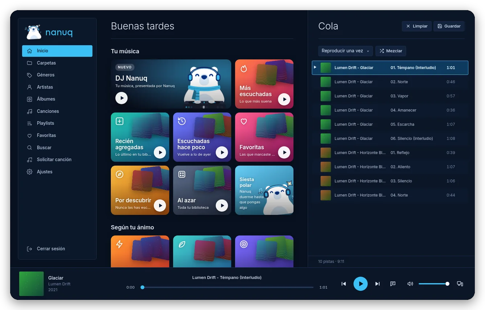
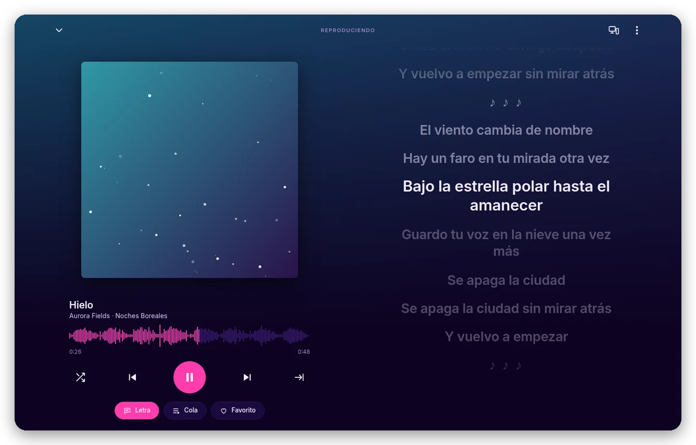
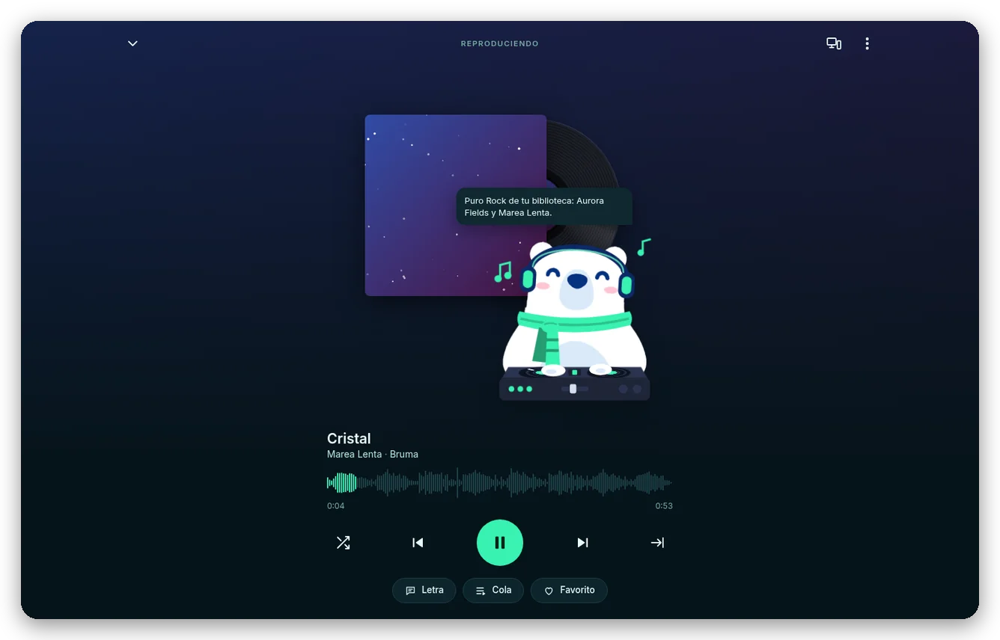
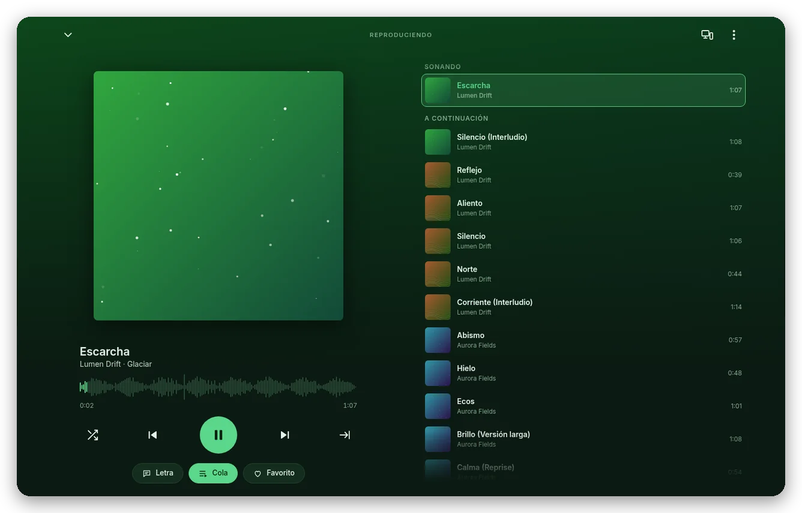
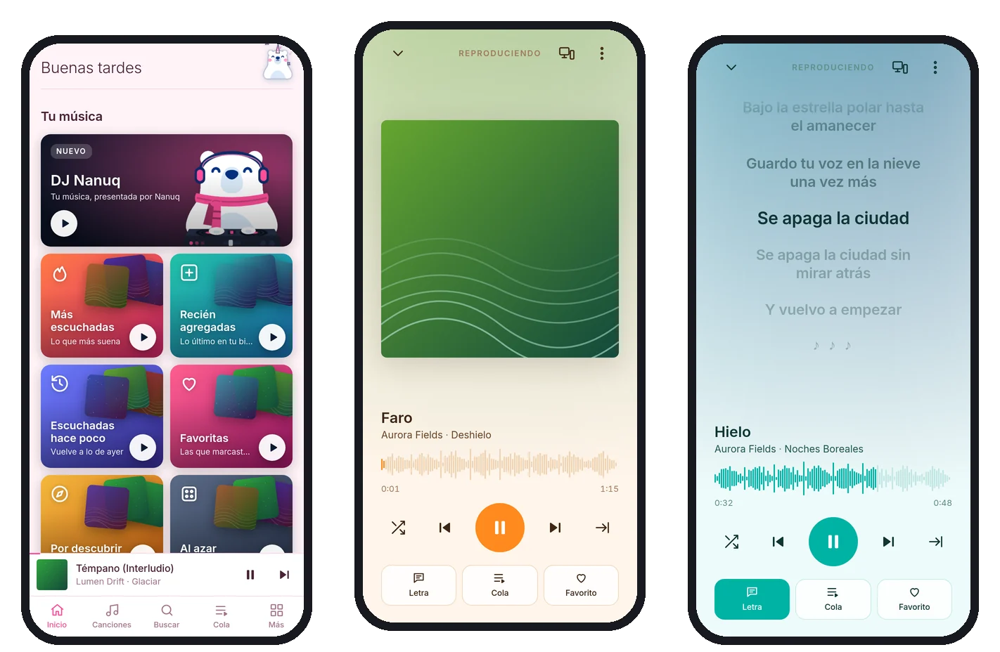
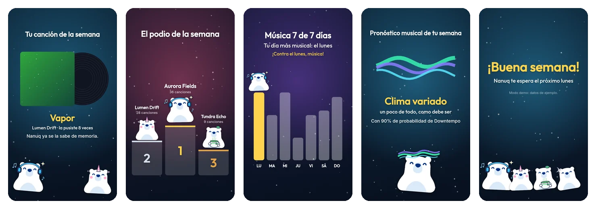
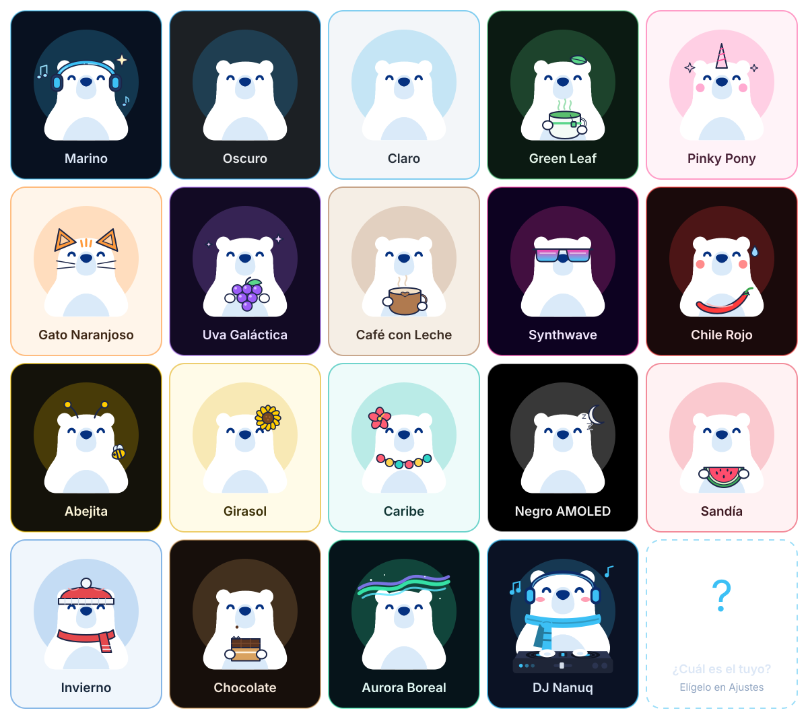

<p align="right"><a href="README.md">Español</a> · <b>English</b></p>

<p align="center">
  
</p>

<p align="center">
  <b>A music player for your <a href="https://jellyfin.org">Jellyfin</a> server</b><br>
  Synced lyrics, a DJ that builds your session, parties with your friends, 18 themes with their own Nanuq and your year on video.<br>
  In English and Spanish.
</p>

<p align="center">
  <a href="#%EF%B8%8F-install">Install</a> ·
  <a href="#-what-it-does">What it does</a> ·
  <a href="#-18-themes-18-nanuqs">Themes</a> ·
  <a href="#-privacy-and-security">Privacy</a> ·
  <a href="#%EF%B8%8F-build">Build</a> ·
  <a href="#-manuals">Manuals</a> ·
  <a href="#-license">License</a>
</p>

<p align="center">
  <b>Android</b> · <b>Linux</b> (AppImage, Flatpak, RPM) · <b>Windows</b> · <b>Browser</b> (PWA)<br>
  Free software under the <a href="LICENSE">GPLv3</a>
</p>

---

## 🐻‍❄️ Meet Nanuq

Nanuq is a polar bear with headphones who lives in your player. It dances when each song starts, gets sad for a moment when you pause, fills the gaps on the home screen with animated scenes and, every now and then, gets visits from the Nanuqs of other themes.

Behind the bear there's a full player for your Jellyfin library: in English or Spanish, with no ads or extra accounts, and made for **your** server.

<p align="center">
  
</p>

## ✨ What it does

### 🎤 Lyrics that follow the song

The line that's playing lights up and the lyrics scroll on their own; tap any line to jump to that moment. If a song has no lyrics, find them on LrcLib or paste them yourself and **sync them by hand** by tapping “Mark” to the beat: Nanuq saves them in your Jellyfin.

Don't know the song's name but remember a bit of the lyrics? **Search by lyrics**: type what you remember in Search and it shows up under “In the lyrics”, with the line highlighted.

<p align="center">
  
</p>

### 🎧 DJ Nanuq

A session that never ends, like a radio station made from **your** library: rounds by genre (Pop, Rock, Pop Punk…), trips to another decade, songs you'd forgotten and discoveries. Nanuq introduces each round from its turntable (with a voice, if you want), and each song's cover spins like a record. The DJ prefers what you've never heard or had forgotten, and it **travels with you**: if you send the music to another device, the session continues there. No AI: just rules about your music.

<p align="center">
  
</p>

### 📜 Your queue, always at hand

In the player, the **Queue** button swaps the cover for what's coming up next; **drag** songs to change the order. Plus: automatic mixes for your mood, radio from a song, favorites kept up to date on all your devices and add-to-playlist from anywhere. **Albums are built from your songs' tags**, not by folder: an album split across two folders shows up together.

<p align="center">
  
</p>

### 📱 In your pocket

The same app on your phone, with lock-screen and Bluetooth headphone controls, background playback, **downloads to listen without data** and **what's next in your queue saved ahead of time** (10 minutes, adjustable): if the network gets slow or drops for a moment, you won't notice. Nanuq speaks your phone's language.

<p align="center">
  
</p>

### 🎬 Your week (and your year) on video

In **Settings → Your week with Nanuq**, a video under a minute long with what you listened to: minutes, your song of the week with a drumroll, **your artists' podium**, your most musical day and **your week's music forecast**. The first week of December brings **Your year with Nanuq**, with your music personality (Nanuq dresses up according to your favorite genre). Exportable as MP4, with music made by Nanuq.

<p align="center">
  
</p>

### And also

- 🎉 **Party**: your computer opens a room and your friends join from their phones with a code; everyone sends songs from their own Jellyfin and they play one after another in an **igloo** where everyone's Nanuqs dance (the one who picked the song lifts its cover), with lights, a vinyl record and the lyrics on the ceiling, as karaoke on every phone. In full screen, the “Up next” row can be tapped and dragged, and **↑ ↓** change the volume.
- 📡 **My devices**: one Nanuq plays and the others control it, or send the music from the phone to the computer and it continues at the same second.
- ➕ **Request a song**: ask for a song you don't have and [SomeDL](https://github.com/ChemistryGull/SomeDL) downloads it to your library; Nanuq lets you know when it's ready.
- 🎮 **“Listening to Nanuq” on Discord** (Linux and Windows, optional): the song, the artist and the time on your profile, like with Spotify. If it doesn't show up, Settings tells you why.
- 🔄 **Refresh from Jellyfin** (Settings) and **fade on pause**.
- ⌨️ **System controls**: taskbar, GNOME/KDE panel, media keys and lock screen.
- 🗣️ **In English or Spanish**: pick the language in Settings (it also changes the DJ, the videos and the Party); on Android, the phone's language by default.
- 🌐 Servers by IPv4, IPv6 or name, and (in the apps) automatic discovery of your Jellyfin on the network.

## 🎨 18 themes, 18 Nanuqs

Each theme changes the app's colors **and** Nanuq's costume.

<p align="center">
  
</p>

## 🔒 Privacy and security

- Nanuq talks to **your** Jellyfin server (and to SomeDL, if you set it up); the only external thing is the fonts, from Google Fonts. No accounts, no analytics, no ads.
- Your session, your queue and anything that says something about you are stored **encrypted** on the device (AES-256 with the system keyring on Linux, DPAPI on Windows and the Android keystore).
- Reviewed against malicious servers and metadata, memory and denial-of-service attacks, with a strict content security policy and minimal permissions on every platform.
- The details, known limits and how to report a vulnerability privately are in [SECURITY.en.md](SECURITY.en.md).

## ⬇️ Install

Download the latest version from [Releases](../../releases).

| Platform | File | How |
|---|---|---|
| Android | `nanuq-<version>-release.apk` | Open it on the phone. Details in [android/LEEME.en.md](android/LEEME.en.md) |
| Windows | `nanuq-<version>-setup.exe` | Open it and follow the installer. It isn't signed yet: if Windows says “Windows protected your PC”, tap **More info → Run anyway**. A new version installs over the previous one |
| Linux (Flatpak) | `nanuq-<version>.flatpak` | `flatpak install nanuq-<version>.flatpak`. To update, install the new one **from the terminal** with the same command |
| Linux (any distribution) | `nanuq-<version>-x86_64.AppImage` | `chmod +x` and open it |
| Linux (Fedora/Nobara) | `nanuq-<version>-x86_64.rpm` | `sudo dnf install ./nanuq-<version>-x86_64.rpm` |
| Browser (PWA) | `web/` folder | Host it as is. See [web/LEEME.en.md](web/LEEME.en.md) |

### Verify the official APK

All official Nanuq APKs are signed with the same certificate. Its SHA-256 fingerprint is:

```
9A:B9:59:A9:62:BD:DF:AA:1E:D3:0F:3B:2D:94:8D:55:F8:CB:54:41:B4:74:02:30:1E:EB:E7:9D:5A:74:D3:BD
```

To check an APK before installing it (`apksigner` comes with the Android SDK build-tools):

```
apksigner verify --print-certs nanuq-<version>-release.apk
```

The “certificate SHA-256 digest” it shows must be the same (without the `:` and in lowercase). If it doesn't match, **don't install it**: it isn't an official APK. Android also won't let you install an APK signed with another key over Nanuq.

You need **Jellyfin 10.9 or newer** for lyrics (everything else works from 10.8). For exact recaps, install the **Playback Reporting** plugin in Jellyfin.

## 📘 Manuals

| | English | Español |
|---|---|---|
| **User manual**: everything you can do, step by step | [user_manual.pdf](docs/manuals/en/user_manual.pdf) | [user_manual.pdf](docs/manuals/es/user_manual.pdf) |
| **Technical manual**: architecture (with diagrams) and every function in the code | [technical_manual.pdf](docs/manuals/en/technical_manual.pdf) | [technical_manual.pdf](docs/manuals/es/technical_manual.pdf) |

## 🛠️ Build

The whole interface lives in `web/` (`index.html`, `i18n.js`, `app.js` and `app.css`), with no build step and no dependencies. The Android, Linux and Windows apps wrap it: every build copies the same PWA, so a change in `web/` reaches all of them.

```
scripts/build.sh            # rebuilds everything with the current version
scripts/build.sh patch      # bumps the version (1.30.2 → 1.30.3) and builds everything
scripts/build.sh minor      # 1.30.2 → 1.31.0
scripts/build.sh android    # just the APK (also: linux, flatpak, windows)
```

Packages end up in `dist/<version>/`.

| Platform | Folder | Needs | Guide |
|---|---|---|---|
| Web (PWA) | `web/` | nothing | [web/LEEME.en.md](web/LEEME.en.md): hosting, IPv6, languages, lyrics, favorites, Request a song (SomeDL), Party |
| Android (APK) | `android/` | JDK 21 in `~/.local/opt/jdk21`, Android SDK in `~/Android/Sdk` (platform 35, build-tools 35) and the signing key | [android/LEEME.en.md](android/LEEME.en.md): tools, signing, installing |
| Linux (AppImage, RPM) | `linux/` | Node.js (`npm install` in `linux/`), `fpm` in `~/bin` and `rpm-build` for the RPM | [linux/LEEME.en.md](linux/LEEME.en.md) |
| Flatpak | `linux/flatpak/` | `org.flatpak.Builder` and the 26.08 runtimes from Flathub | [linux/LEEME.en.md](linux/LEEME.en.md#flatpak) |
| Windows (NSIS installer) | `linux/` | The same as Linux, plus **Wine** (to set the `.exe` icon and details) | `scripts/build.sh windows` |

**Flatpak with updates:** `linux/flatpak/build-flatpak.sh` publishes each build to a signed local Flatpak repository (`~/.local/share/nanuq/flatpak-repo`). With `build-flatpak.sh --install`, the app is installed from that repository and each new version arrives as an update (software center or `flatpak update`), without uninstalling or losing data.

<details>
<summary><b>Project structure</b></summary>

```
web/                    The app: the only source of the interface
  index.html            The app's structure (HTML) and its security policy (CSP)
  i18n.js               Languages: the English translation of every text (tx)
  app.js                All the app's code
  app.css               All the styles and the 18 themes
  sw.js                 PWA service worker (it only stores the app, never the music)
  manifest.webmanifest  PWA manifest
  icons/                Icons and logo
android/                WebView + native services (MediaSession, downloads, queue ahead of time, encrypted store, local server, network discovery)
  bridge/               android-bridge.js: connects navigator.mediaSession with Android (injected at build time)
  build-apk.sh
linux/                  Electron (Linux and Windows): main.js, preload.js, prepare-web.js (copies web/ to www/), collect.js
  flatpak/              Manifest, .desktop, metainfo and build-flatpak.sh (local repository with updates)
scripts/build.sh        Bumps the version and builds every platform
docs/readme/            This README's images (made with the app's Nanuqs)
docs/manuals/           PDF manuals (es/ and en/) and their HTML source (src/)
CLAUDE.md               Instructions for Claude Code
LICENSE                 GNU GPL version 3 license (full text)
SECURITY.en.md          What the app protects, its limits and how to report vulnerabilities (Spanish: SECURITY.md)
dist/                   (not in git) Packages per version; dist/_build/ keeps the intermediate files
instaladores/           (not in git) Downloaded installers for the Android SDK, Gradle and gh
```

</details>

<details>
<summary><b>Versions, local servers and Android signing</b></summary>

- **Versions:** the version comes from `const VERSION` in `web/app.js`; the APK (`versionCode`), the Linux/Windows `package.json` and the Flatpak take it from there at build time, and `CACHE` in `web/sw.js` makes browsers drop the old copy. `scripts/build.sh patch|minor|major` changes both.
- **Local servers:** Nanuq doesn't open ports to the network, except while you have a **Party** open on the computer (TCP 47864 and UDP 47865 on your local network, with a 6-digit code; they close when it ends). On Android, a server on `127.0.0.1` (random port, routes with a random token) hands downloaded and ahead-of-time songs to the player. On Linux and Windows, one on `127.0.0.1:47863` serves the interface to the Electron window. Jellyfin server discovery (UDP 7359) and My devices (Jellyfin's WebSocket) are outgoing connections.
- **Android signing:** the release APK is signed with `~/.android/nanuq-release.jks` and the password is in `android/keystore.properties`. **Neither is in this repository.** Back them up separately: without that key, APK updates can't be published.

</details>

## 📄 License

Nanuq is **free software**: you can use, study, share and modify it under the terms of the **GNU General Public License, version 3 or (at your option) any later version** (GPL-3.0-or-later). The full text is in [LICENSE](LICENSE).

In short: if you distribute Nanuq or a modified version, you must do so under the same license and offer its source code. It comes with **no warranty**.

Copyright © 2026 Fleyrer and Nanuq contributors.

The desktop apps include [Electron](https://www.electronjs.org/) (MIT license); the Inter and Outfit fonts (SIL Open Font License) are loaded from Google Fonts. Jellyfin is an independent project: Nanuq is not affiliated with it.

<p align="center">
  <sub>Made with 🐻‍❄️ and lots of music.</sub>
</p>
