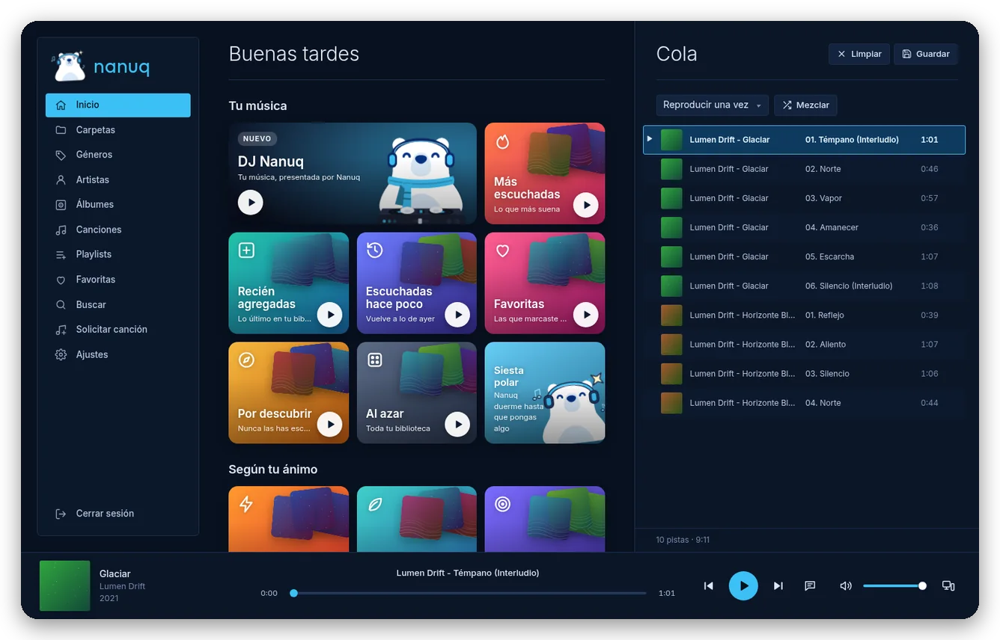
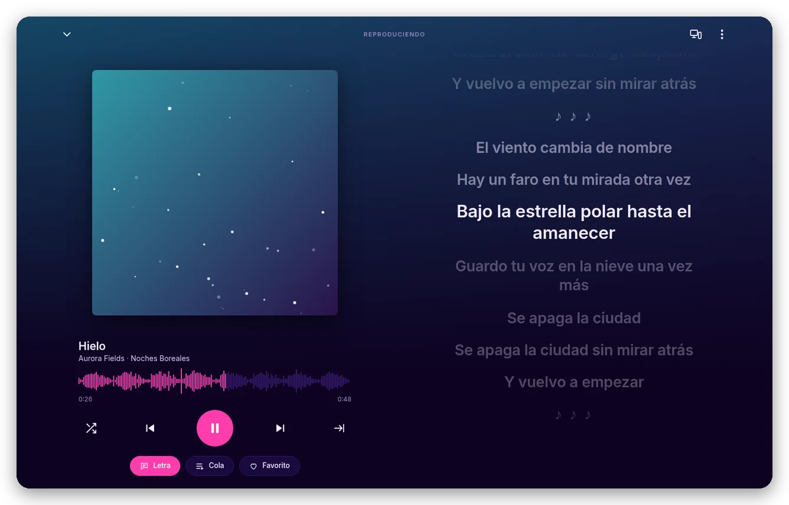
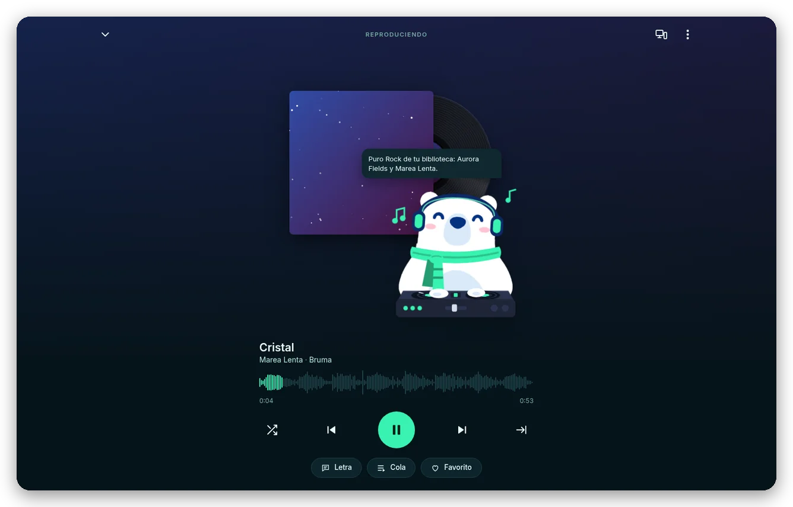
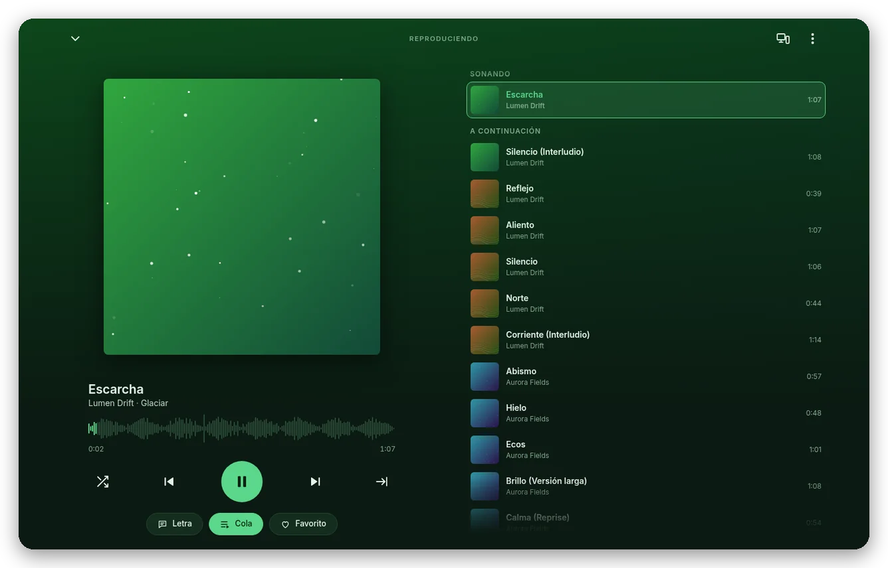
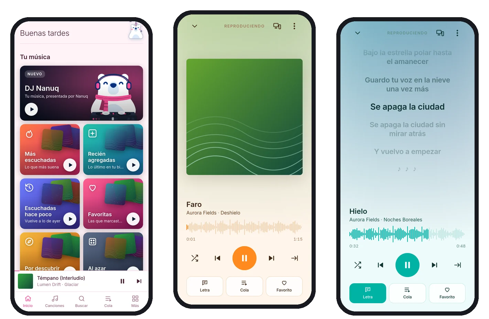
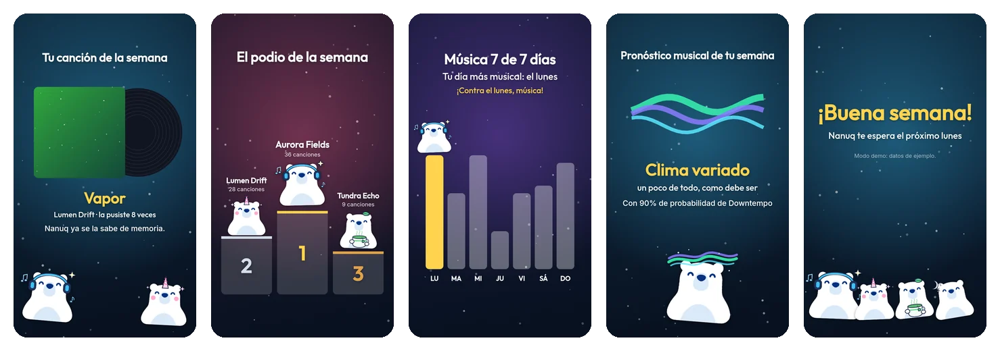
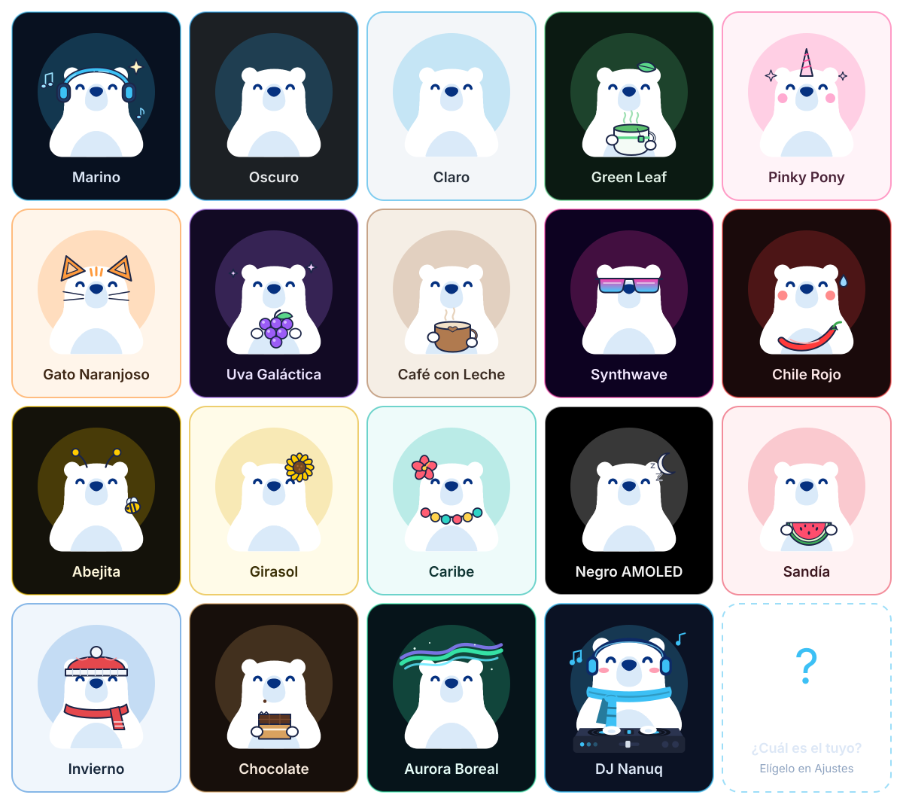

<p align="right"><b>Español</b> · <a href="README.en.md">English</a></p>

<p align="center">
  
</p>

<p align="center">
  <b>Un reproductor de música para tu servidor <a href="https://jellyfin.org">Jellyfin</a></b><br>
  Letras sincronizadas, un DJ que arma tu sesión, fiestas con tus amigos, 18 temas con su propio Nanuq y tu año en video.<br>
  En español y en inglés.
</p>

<p align="center">
  <a href="#-instalar">Instalar</a> ·
  <a href="#-lo-que-hace">Lo que hace</a> ·
  <a href="#-18-temas-18-nanuqs">Temas</a> ·
  <a href="#-privacidad-y-seguridad">Privacidad</a> ·
  <a href="#%EF%B8%8F-compilar">Compilar</a> ·
  <a href="#-manuales">Manuales</a> ·
  <a href="#-licencia">Licencia</a>
</p>

<p align="center">
  <b>Android</b> · <b>Linux</b> (AppImage, Flatpak, RPM) · <b>Windows</b> · <b>Navegador</b> (PWA)<br>
  Software libre bajo la <a href="LICENSE">GPLv3</a>
</p>

---

## 🐻‍❄️ Conoce a Nanuq

Nanuq es un oso polar con audífonos que vive en tu reproductor. Baila cuando empieza cada canción, se pone triste un momento cuando la pausas, llena los huecos de la pantalla de inicio con escenas animadas y, de vez en cuando, recibe visitas de los Nanuqs de otros temas.

Detrás del oso hay un reproductor completo para tu biblioteca de Jellyfin: en español o en inglés, sin anuncios ni cuentas extra, y pensado para **tu** servidor.

<p align="center">
  
</p>

## ✨ Lo que hace

### 🎤 Letras que siguen la canción

La línea que suena se ilumina y la letra avanza sola; toca cualquier línea para saltar a ese momento. Si una canción no tiene letra, búscala en LrcLib o pégala tú y **sincronízala a mano** tocando «Marcar» al ritmo de la música: Nanuq la guarda en tu Jellyfin.

¿No sabes cómo se llama, pero te sabes un pedazo de la letra? **Búscala por la letra**: escribe lo que recuerdas en Buscar y aparece en «En las letras», con la línea resaltada.

<p align="center">
  
</p>

### 🎧 DJ Nanuq

Una sesión que no se acaba, como una estación de radio hecha con **tu** biblioteca: rondas por género (Pop, Rock, Pop Punk…), viajes a otra década, canciones que tenías olvidadas y descubrimientos. Nanuq presenta cada ronda desde su tornamesa (y, si quieres, con voz), y la portada de cada canción gira como un disco. El DJ prefiere lo que nunca has escuchado o tenías olvidado, y **viaja contigo**: si pasas la música a otro dispositivo, la sesión sigue allá. Sin IA: solo reglas sobre tu música.

<p align="center">
  
</p>

### 📜 Tu cola, siempre a la mano

En el reproductor, el botón **Cola** cambia la portada por lo que viene a continuación; **arrastra** las canciones para cambiar el orden. Además: mezclas automáticas según tu ánimo, radio a partir de una canción, favoritas al día en todos tus dispositivos y agregar a playlists desde cualquier lugar. Los **álbumes se arman con las etiquetas de tus canciones**, no por carpeta: un disco repartido en dos carpetas sale junto.

<p align="center">
  
</p>

### 📱 En tu bolsillo

La misma app en tu teléfono, con controles en la pantalla de bloqueo y los audífonos Bluetooth, música en segundo plano, **descargas para escuchar sin datos** y **lo que sigue en tu cola guardado por adelantado** (10 minutos, ajustable): si la red se pone lenta o se corta un momento, no se nota. Nanuq habla el idioma de tu teléfono.

<p align="center">
  
</p>

### 🎬 Tu semana (y tu año) en video

En **Ajustes → Tu semana con Nanuq**, un video de menos de un minuto con lo que escuchaste: minutos, tu canción de la semana con redoble de tambor, **el podio de tus artistas**, tu día más musical y el **pronóstico musical de tu semana**. La primera semana de diciembre llega **Tu año con Nanuq**, con tu personalidad musical (Nanuq se disfraza según tu género favorito). Exportable en MP4, con música hecha por Nanuq.

<p align="center">
  
</p>

### Y además

- 🎉 **Fiesta**: tu computadora abre una sala y tus amigos se unen desde su teléfono con un código; cada quien manda canciones de su propio Jellyfin y suenan una tras otra en un **iglú** donde bailan los Nanuqs de todos (el de quien escogió la canción levanta su carátula), con luces, disco de vinilo y la letra en el techo, como karaoke en cada teléfono. A pantalla completa, la fila «A continuación» se toca y se arrastra, y **↑ ↓** cambian el volumen.
- 📡 **Mis dispositivos**: un Nanuq suena y los demás lo controlan, o pasa la música del teléfono a la computadora y sigue en el mismo segundo.
- ➕ **Solicitar canción**: pide una canción que no tienes y [SomeDL](https://github.com/ChemistryGull/SomeDL) la baja a tu biblioteca; Nanuq te avisa cuando está lista.
- 🎮 **«Escuchando Nanuq» en Discord** (Linux y Windows, opcional): la canción, el artista y el tiempo en tu perfil, como con Spotify. Si no aparece, Ajustes te dice por qué.
- 🔄 **Actualizar desde Jellyfin** (Ajustes) y **desvanecer al pausar**.
- ⌨️ **Controles del sistema**: barra de tareas, panel de GNOME/KDE, teclas multimedia y pantalla de bloqueo.
- 🗣️ **En español o en inglés**: elige el idioma en Ajustes (también el DJ, los videos y la Fiesta); en Android, por omisión, el del teléfono.
- 🌐 Servidores por IPv4, IPv6 o nombre, y (en las apps) búsqueda automática de tu Jellyfin en la red.

## 🎨 18 temas, 18 Nanuqs

Cada tema cambia los colores de la app **y** el disfraz de Nanuq.

<p align="center">
  
</p>

## 🔒 Privacidad y seguridad

- Nanuq habla con **tu** servidor Jellyfin (y con SomeDL, si lo configuras); lo único externo son las fuentes tipográficas, de Google Fonts. Sin cuentas, sin analítica, sin anuncios.
- Tu sesión, tu cola y lo que dice algo de ti se guardan **cifrados** en el dispositivo (AES-256 con el llavero del sistema en Linux, DPAPI en Windows y el almacén de claves de Android).
- Revisada contra servidores y metadatos maliciosos, ataques de memoria y de denegación de servicio, con política de seguridad de contenido estricta y permisos mínimos en cada plataforma.
- Los detalles, los límites conocidos y cómo reportar una vulnerabilidad en privado están en [SECURITY.md](SECURITY.md).

## ⬇️ Instalar

Descarga la última versión en [Releases](../../releases).

| Plataforma | Archivo | Cómo |
|---|---|---|
| Android | `nanuq-<versión>-release.apk` | Ábrelo en el teléfono. Detalles en [android/LEEME.md](android/LEEME.md) |
| Windows | `nanuq-<versión>-setup.exe` | Ábrelo y sigue el instalador. Aún no está firmado: si Windows dice «Windows protegió tu PC», toca **Más información → Ejecutar de todas formas**. Una versión nueva se instala encima de la anterior |
| Linux (Flatpak) | `nanuq-<versión>.flatpak` | `flatpak install nanuq-<versión>.flatpak`. Para actualizar, instala el nuevo **desde la terminal** con el mismo comando |
| Linux (cualquier distribución) | `nanuq-<versión>-x86_64.AppImage` | `chmod +x` y ábrelo |
| Linux (Fedora/Nobara) | `nanuq-<versión>-x86_64.rpm` | `sudo dnf install ./nanuq-<versión>-x86_64.rpm` |
| Navegador (PWA) | carpeta `web/` | Alójala tal cual. Ver [web/LEEME.md](web/LEEME.md) |

### Verificar el APK oficial

Todos los APK oficiales de Nanuq están firmados con el mismo certificado. Su huella SHA-256 es:

```
9A:B9:59:A9:62:BD:DF:AA:1E:D3:0F:3B:2D:94:8D:55:F8:CB:54:41:B4:74:02:30:1E:EB:E7:9D:5A:74:D3:BD
```

Para comprobar un APK antes de instalarlo (`apksigner` viene en las build-tools del Android SDK):

```
apksigner verify --print-certs nanuq-<versión>-release.apk
```

El «certificate SHA-256 digest» que muestra debe ser el mismo (sin los `:` y en minúsculas). Si no coincide, **no lo instales**: no es un APK oficial. Android, además, no deja instalar encima de Nanuq un APK firmado con otra llave.

Necesitas **Jellyfin 10.9 o más nuevo** para las letras (lo demás funciona desde 10.8). Para resúmenes exactos, instala en Jellyfin el plugin **Playback Reporting**.

## 📘 Manuales

| | Español | English |
|---|---|---|
| **Manual de usuario**: todo lo que puedes hacer, paso a paso | [user_manual.pdf](docs/manuals/es/user_manual.pdf) | [user_manual.pdf](docs/manuals/en/user_manual.pdf) |
| **Manual técnico**: arquitectura (con diagramas) y cada función del código | [technical_manual.pdf](docs/manuals/es/technical_manual.pdf) | [technical_manual.pdf](docs/manuals/en/technical_manual.pdf) |

## 🛠️ Compilar

Toda la interfaz vive en `web/` (`index.html`, `i18n.js`, `app.js` y `app.css`), sin compilar y sin dependencias. Las apps de Android, Linux y Windows la envuelven: cada compilación copia la misma PWA, así que un cambio en `web/` llega a todas.

```
scripts/build.sh            # recompila todo con la versión actual
scripts/build.sh patch      # sube la versión (1.30.2 → 1.30.3) y compila todo
scripts/build.sh minor      # 1.30.2 → 1.31.0
scripts/build.sh android    # solo el APK (también: linux, flatpak, windows)
```

Los paquetes quedan en `dist/<versión>/`.

| Plataforma | Carpeta | Necesita | Guía |
|---|---|---|---|
| Web (PWA) | `web/` | nada | [web/LEEME.md](web/LEEME.md): alojarla, IPv6, idiomas, letras, favoritas, Solicitar canción (SomeDL), Fiesta |
| Android (APK) | `android/` | JDK 21 en `~/.local/opt/jdk21`, Android SDK en `~/Android/Sdk` (platform 35, build-tools 35) y la llave de firma | [android/LEEME.md](android/LEEME.md): herramientas, firma, instalar |
| Linux (AppImage, RPM) | `linux/` | Node.js (`npm install` en `linux/`), `fpm` en `~/bin` y `rpm-build` para el RPM | [linux/LEEME.md](linux/LEEME.md) |
| Flatpak | `linux/flatpak/` | `org.flatpak.Builder` y los runtimes 26.08 de Flathub | [linux/LEEME.md](linux/LEEME.md#flatpak) |
| Windows (instalador NSIS) | `linux/` | Lo mismo que Linux, más **Wine** (para poner el ícono y los datos del `.exe`) | `scripts/build.sh windows` |

**Flatpak con actualizaciones:** `linux/flatpak/build-flatpak.sh` publica cada compilación en un repositorio Flatpak local firmado (`~/.local/share/nanuq/flatpak-repo`). Con `build-flatpak.sh --install`, la app se instala desde ese repositorio y cada versión nueva llega como actualización (centro de software o `flatpak update`), sin desinstalar ni perder datos.

<details>
<summary><b>Estructura del proyecto</b></summary>

```
web/                    La app: única fuente de la interfaz
  index.html            Estructura de la app (HTML) y su política de seguridad (CSP)
  i18n.js               Idiomas: la traducción al inglés de cada texto (tx)
  app.js                Todo el código de la app
  app.css               Todos los estilos y los 18 temas
  sw.js                 Service worker de la PWA (solo guarda la app, nunca la música)
  manifest.webmanifest  Manifiesto de la PWA
  icons/                Íconos y logo
android/                WebView + servicios nativos (MediaSession, descargas, cola por adelantado, almacén cifrado, servidor local, búsqueda en la red)
  bridge/               android-bridge.js: conecta navigator.mediaSession con Android (se inyecta al compilar)
  build-apk.sh
linux/                  Electron (Linux y Windows): main.js, preload.js, prepare-web.js (copia web/ a www/), collect.js
  flatpak/              Manifiesto, .desktop, metainfo y build-flatpak.sh (repositorio local con actualizaciones)
scripts/build.sh        Sube la versión y compila todas las plataformas
docs/readme/            Imágenes de este README (generadas con los Nanuqs de la app)
docs/manuals/           Manuales en PDF (es/ y en/) y su fuente HTML (src/)
CLAUDE.md               Instrucciones para Claude Code
LICENSE                 Licencia GPL versión 3 (texto completo)
SECURITY.md             Qué protege la app, sus límites y cómo reportar vulnerabilidades (en inglés: SECURITY.en.md)
dist/                   (no está en git) Paquetes por versión; dist/_build/ guarda lo intermedio
instaladores/           (no está en git) Instaladores descargados del Android SDK, Gradle y gh
```

</details>

<details>
<summary><b>Versiones, servidores locales y firma de Android</b></summary>

- **Versiones:** la versión sale de `const VERSION` en `web/app.js`; el APK (`versionCode`), el `package.json` de Linux/Windows y el Flatpak la toman de ahí al compilar, y `CACHE` en `web/sw.js` hace que los navegadores descarten la copia vieja. `scripts/build.sh patch|minor|major` cambia los dos.
- **Servidores locales:** Nanuq no abre puertos hacia la red, salvo mientras tienes abierta una **Fiesta** en la computadora (TCP 47864 y UDP 47865 en tu red local, con código de 6 dígitos; se cierran al terminarla). En Android, un servidor en `127.0.0.1` (puerto al azar, rutas con token aleatorio) entrega las canciones descargadas y las guardadas por adelantado al reproductor. En Linux y Windows, uno en `127.0.0.1:47863` sirve la interfaz a la ventana de Electron. La búsqueda de servidores Jellyfin (UDP 7359) y Mis dispositivos (WebSocket de Jellyfin) son conexiones de salida.
- **Firma de Android:** el APK de release se firma con `~/.android/nanuq-release.jks` y la contraseña está en `android/keystore.properties`. **Ninguno de los dos está en este repositorio.** Respáldalos aparte: sin esa llave no se pueden publicar actualizaciones del APK.

</details>

## 📄 Licencia

Nanuq es **software libre**: puedes usarlo, estudiarlo, compartirlo y modificarlo bajo los términos de la **Licencia Pública General de GNU, versión 3 o (a tu elección) cualquier versión posterior** (GPL-3.0-or-later). El texto completo está en [LICENSE](LICENSE).

En pocas palabras: si distribuyes Nanuq o una versión modificada, tienes que hacerlo con la misma licencia y ofrecer su código fuente. Se distribuye **sin ninguna garantía**.

Copyright © 2026 Fleyrer y colaboradores de Nanuq.

Las apps de escritorio incluyen [Electron](https://www.electronjs.org/) (licencia MIT); las fuentes Inter y Outfit (SIL Open Font License) se cargan de Google Fonts. Jellyfin es un proyecto independiente: Nanuq no está afiliado a él.

<p align="center">
  <sub>Hecho con 🐻‍❄️ y mucha música.</sub>
</p>
